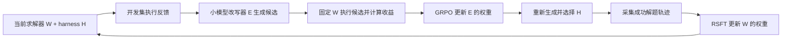
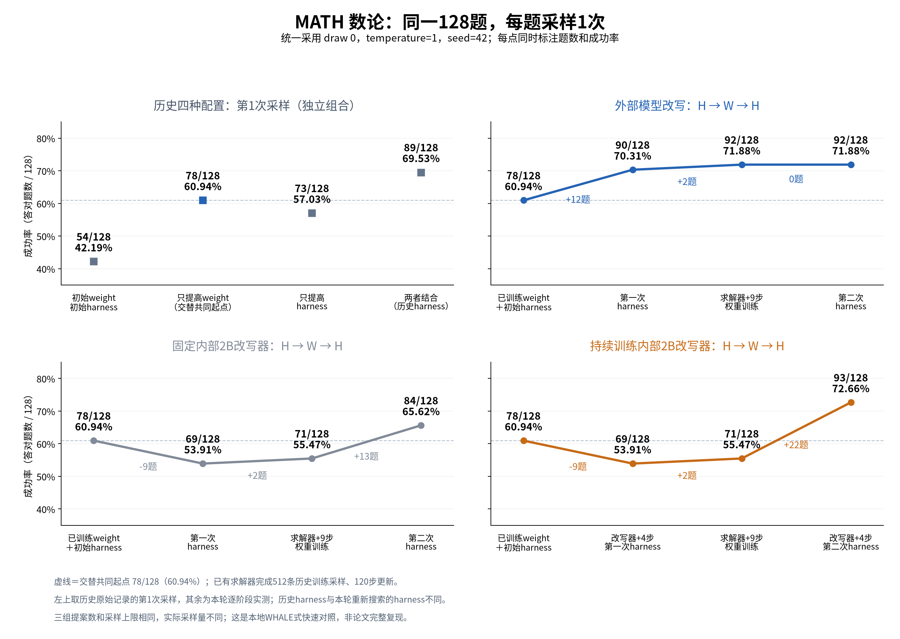

# Coevolve: SAO / MA-SAO harness–weight co-evolution

**基于 [WHALE](https://github.com/krafton-ai/WHALE) 的双模型改进：不仅训练 Solver，也训练负责修改可执行 harness 的 Engineer。先建立足够强的 SAO baseline，再验证 MA-SAO 的额外收益。**

**Agent 先读本节，再读 [项目状态](docs/PROJECT_STATE.md)、[算法与冻结协议](docs/MA_SAO.md) 和 [实验日志](docs/EXPERIMENT_LOG.md)。下面的2B RSFT/GRPO配置是历史原型，不是当前9B主线的启动入口。**

## 当前任务与主要结论

更新快照：**2026-10-02：E15/W79 的8小时自动交替实验**。运行状态以服务器上的完成/释放收据为准。

### 新任务：同起点、同192条预算的Harness-R1对照

新增[匹配GRPO入口](whale_local/sao_bridge/alfworld_matched_grpo.py)与
[冻结参数](configs/alfworld_engineer_matched_grpo.json)，先完成此对照及W0/W1的200题评测，
再继续真正联合更新的MA-SAO。目前是实现/验证阶段，不能当作已有训练结果。
H2此前固定W1训练，**不依赖退化的W2**；新的MA也从H1/W1而不是W2开始。

- 起点仍是官方已RL的`harness-r1` H0，固定W0；不换成SFT或对口官方Engineer。
- 精确复用SAO的24个提示及奖励metadata，每个8条，共192条；6个rollout，
  每轮32条分4个8条minibatch，**不是4个epoch**。保留消费96/192条的checkpoint。
- 直接调用hash固定的官方Relax GRPO奖励标准化、clip及TIS函数，
  运行器为FSDP/vLLM后端适配，**不是完整Relax/Megatron执行栈复现**。
- 同4096 response/32768 context上限，但保留官方GRPO优化器参数；
  轨迹预算相同不代表token/FLOPs相同。SAO的192条包含30条critic-only，
  GRPO没有critic预热。额外reward环境执行、下一轮预取另记，不能隐藏成本。
- 原模型严格加载原生Qwen3.5多模态checkpoint，文本任务不提供视觉输入；
  不重映射或随机初始化语言权重，不改原SearchQA的默认模型约束。
- 排除已有200题训练实例，基础设施故障抛错而非记零分；保留filler，
  固定目标服务与训练器均有独立超时、失败记录和GPU释放审计。

评测入口为[matched GRPO evaluation](whale_local/sao_bridge/alfworld_matched_grpo_eval.py)：
预先固定最终192条消费checkpoint，不依据200题选择96/192模型；
使用与固定H1相同的W79历史证据/seed生成8个补丁，保留非法及重复槽。
为保证6小时MA结论的时间预算，仅在W1测24题mean@2选一个补丁，随后不再改动，
W0/W1分别完整重测同200题mean@1并报告严格197题。W0列仍是W1补丁的迁移测试，
不是为W0单独重选的最优补丁。SAO采用历史选择的step15，因此不能把此次对照
说成checkpoint选择过程完全相同；96点保留供后续审计，不参与本轮最终选择。

## ALFWorld模型起点、训练步数与checkpoint

基础架构均为**Qwen3.5-9B**。Solver从官方`target-agent-sft`开始，
不是裸基座；Engineer从官方已经RL训练过的`harness-r1`开始，
不是SFT-only。官方对口比较使用另一个发布checkpoint
`agent-sft-harness-r1`。这三者均来自revision
`f6a915953f8206f3f5c7ef0b40240e1f4d2b6676`，不得混淆其训练对象。

| 阶段 | 本轮初始化及固定对端 | Native步数 | Critic-only预热 | Actor更新 | 被采用checkpoint |
|---|---|---:|---:|---:|---|
| H1 | 官方Engineer，固定W0评奖励 | 32 | 5 | 27 | **step15**，累计11次本地Actor更新；中间模型 |
| W1 | 官方Agent-SFT W0，固定空harness | 80 | 5 | 75 | **step79**，最后模型 |
| H2 | H1-step15，固定W1 | 32 | 5 | 27 | **step31**，本轮最后模型 |
| W2候选 | W1-step79，固定选中的h2补丁 | 80 | 5 | 75 | **没有被采用**；step39和79均被拒绝 |

step编号从0开始，且每个阶段重新计数。H2在保留的H1权重上再做27次Actor更新
（本地保留路径共11+27=38次）；候选W2在W1上再做75次
（共75+75=150次）。这不包含官方模型预先执行的训练，也不等于全部搜索成本。
H1和W1最初独立并行训练；后续交替先H2、后W2，不能说W1在H1补丁上训练。
用户新要求的W2+h2测评明确使用**实际最终W2-step79**，不使用拒绝后回退的W1。

样本数不等于样本效率：H1完整32步消费192条Engineer训练轨迹，其中
162条参与Actor更新，30条用于critic-only预热；选中的step15包含96条
累计消费轨迹、66条Actor训练轨迹，但不能因此抹去后续训练与筛选成本。
Harness-R1开源README示例为174个rollout batch、每批4个prompt、每prompt
8条样本，即5568条名义生成轨迹；这只是参考配置，不是已核验的发布模型日志。
192/5568约1/29只能描述局部消费数比例，不能宣称29倍样本效率：
我们的Engineer继承了官方RL权重，起点/任务/目标执行成本/效果均未匹配。

SAO依赖[fooSynaptic/Single-rollout-async-Optimization](https://github.com/fooSynaptic/Single-rollout-async-Optimization)，
固定ac2728149041b5f15ceb75413f467ce0659179cf；它明确标注为**非官方复现**，
不是论文作者官方实现。底层为[inclusionAI/AReaL](https://github.com/inclusionAI/AReaL)，
固定3cf0dfbd2b0fbeabd6977184980e189d1567747a，实际执行SAO补丁后的PPOTrainer。
本项目增加环境/轨迹接线、终止GAE修复及监督管理，快速配方critic每步1次，
不同于上游默认K=2；不得声称未经修改的论文原版复现。

## 新补测：实际W2+h2严重退化（2026-10-02 16:48 UTC）

按用户要求测实际最终W2-step79，不使用选择失败后保留的W1。
相同200题全部重新单次采样，冻结同一h2，分两节点100/100题，
temperature1、总completion4096、相同任务seed。

| 系统 | 200题成功率 | 成功数 | 严格197题 |
|---|---:|---:|---:|
| W1，无harness（既有参考） | 87.00% | 174/200 | 87.31% |
| 实际W2，无harness | **50.00%** | 100/200 | 50.76% |
| W1+h2（既有参考） | 92.00% | 184/200 | 91.88% |
| 实际W2+h2 | **63.50%** | 127/200 | 63.96% |

W2+h2比W1+h2低**28.50pp**，题级95%区间[-35.50,-21.50]pp。
这支持此前拒绝W2、保留W1的决定；不是证明交替训练闭环成功。
W2权重SHA256为46fa776d8652188aba42f54212a9c7884db91ab42785fe1fbbc49bb11b018ea9，
已验证与W1权重不同。约11分钟完成，原生来源hash、200条唯一sample0、
seed/token预算及两个节点GPU释放全部核验。退化根因尚未定位。
证据：[W2补测收据](runs/alfworld_w2_h2_200_v1/COMPLETE.json)。

## 前次核心结果：200题单次测评（2026-10-02 16:04 UTC）

用户要求排除训练题并尽快扩大验证。此前实际为24题，因此新增176题，
已有24题只取预先固定的sample0，不挑成功样本。模型和harness全部冻结，
temperature1、每episode总completion预算4096，每题一次。

| 系统 | 200题成绩 | 成功数 | 严格目标组隔离197题 |
|---|---:|---:|---:|
| W0，不加harness | **73.50%** | 147/200 | 73.10% |
| W0 + 官方对口Harness-R1 | **83.00%** | 166/200 | 82.74% |
| W0 + 固定H1 | **74.00%** | 148/200 | 74.11% |
| W1，不加harness | **87.00%** | 174/200 | 87.31% |
| W1 + 同一固定H1 | **90.50%** | 181/200 | 90.36% |
| W1 + 固定H2 | **92.00%** | 184/200 | 91.88% |

200个game实例均不在本项目训练范围。197题还排除了全部训练目标组
（实际179个不同goal-group）；其余3个未训练实例291/414/467与训练题
共享目标组，因此单列197题严格口径。训练排除覆盖旧0-239题及完整2296个
独立训练catalogue实例；不能据此保证官方发布模型的全部预训练数据不可见。
新增题中83题此前封存，本次已打开；这些题以后不能再称为未打开测试。

纯权重收益**+13.50pp**，固定H1对W0仅**+0.50pp**；
H1对W1为**+3.50pp**，H2比H1再高**1.50pp**。
最好系统相对官方同口径83%为**+9.00pp**，并非沿用论文84%计算。
H2-H1的题级95%区间[-1.50,+5.00]pp，不能宣称稳定显著更好。
旧24题的97.92%不再作为较大样本的主结果；只看新增176题，
W0/官方/H1/W1/W1+H1/W1+H2分别为
73.86%/82.95%/74.43%/87.50%/89.77%/91.48%。
旧24题参与过选择，且更大题池也有开发评测历史，因此不是完全未用过的
确认性测试；训练/选择预算不匹配，不能直接推断算法优越性。

第一次两节点均因worker interact ReadError返回502而中断，未记为模型失败。
57942d1改为新建本地worker连接、不重试可能已执行的动作；真实TCP测试复现
连接复用失败，并验证新连接方案。18测试及6subtest通过，重跑完整完成。
从首次启动约30.5分钟，恢复轮16.6分钟，未达到最初15分钟预期。
失败及中止的同配置尝试都保留并计入成本，不伪称只有一次计算。

结果在[200题收据](runs/alfworld_core_200_oneshot_v2/COMPLETE.json)和
[排除审计](runs/alfworld_core_200_oneshot_v2/COHORT_AUDIT.json)；
[合并入口](whale_local/sao_bridge/alfworld_core_extend.py)验证200条唯一
sample0记录、seed/token预算及原始报告hash。GPU已释放，filler仍active。

## 历史核心结果：24题同口径快速测评（2026-10-02）

用户优先要求核心数据表，node3/node4已并行补测。统一24题、每题2次，
Solver temperature1、每episode总completion预算4096、seed6000045。
W0是官方Agent-SFT Solver；W1是已验证的SAO-v4-step79。

| 系统 | 本次成功率 | 成功次数 |
|---|---:|---:|
| W0，不加harness | **68.75%** | 33/48 |
| W0 + 官方对口Harness-R1（8候选择优） | **85.42%** | 41/48 |
| W0 + 我们的固定H1 | **75.00%** | 36/48 |
| W1，不加harness | **87.50%** | 42/48 |
| W1 + 同一固定H1 | **91.67%** | 44/48 |
| W1 + 固定H2 | **97.92%** | 47/48 |

官方发布的`agent-sft-harness-r1`已实际完成8候选快速复测，
全部8/8合法，候选平均**80.21%**，最优**85.42%**；不是沿用论文84%。
H1是此前针对W1选出的共同固定补丁，本次不换补丁测它对W0/W1的作用；
75%不是E15 Engineer对W0重新择优的能力上限。额外的同输入8候选
Engineer诊断与必需核心表分开，不能把候选平均当作固定系统成绩。

15:08 UTC额外诊断也已完成：相同W0、相同8个Engineer输入与提案预算，
官方提案平均**80.21%**、8选1 **85.42%**、合法8/8；
我们的H1提案平均**69.53%**、8选1 **81.25%**、合法7/8。
因此，即使也允许H1在W0上8选1，本次仍低于对口官方Engineer；
不能声称H1本身已经超过官方Harness-R1。两种选法的分数都不改写上述
固定H1系统行，也不改写旧70题greedy/per-turn预算的80%。
完整诊断见[匹配Engineer收据](runs/alfworld_core_quick_20261002_v1/ENGINEER_MATCHED_DIAGNOSTIC.json)。

本次纯W收益**+18.75pp**，固定H1对W0为**+6.25pp**；
H2叠加到W1为**+10.42pp**，比W1+H1高**6.25pp**。
最好系统比本地官方8选1高**12.50pp**，题级95%区间[+2.08,+25.00]pp。
但这是反复使用的选择开发集，且历史训练/搜索预算不相同，
**不是论文500题胜出或公平训练算法优越性的正式证据**。
旧W1+H2的70题主报告仍为96.43%，不被本次97.92%替换。

此前4B为**数学任务**、固定空harness、512题mean@2：
seed42 **41.50%→56.54%（+15.04pp）**；
seed43 **38.18%→51.56%（+13.38pp）**；
平均**+14.21pp**，通过两seed强门槛。不是4B ALFWorld或Engineer结果。

完整分数、样本数、配对区间和来源hash在
[核心结果收据](runs/alfworld_core_quick_20261002_v1/CORE_TABLE.json)。
对应[官方快速比较入口](whale_local/sao_bridge/alfworld_core_quick.py)
已随源码d2e306a推送。两节点filler保持开启，MA联合试跑暂缓且尚无native更新；
不得把旧MA的回退95%或新试跑的启动成功称为MA训练成绩。

## 历史任务：已验证 H1/W1 起点的自动交替实验

**2026-10-02 14:21 UTC新任务：转向真正的联合轮次MA-SAO首版。**
旧8小时实验已结束：普通SAO选中了H2但拒绝退化的W2；MA在启动时失败，
不能作为算法对照。新的[联合实验入口](whale_local/sao_bridge/joint_experiment.py)
在node3训练Engineer、node4训练Solver，共享版本屏障与同一次合作episode
的最终奖励，两角色优化器持续存在，不再执行几十步H后几十步W的块交替。
首版16轮、4轮critic预热、每角色12次Actor更新，batch8。
Engineer actor保持E15起点，Solver保持v4-W79，critic各自匹配；
Solver学习率暂降到5e-7，避免机械重用此前W2退化配方。

新实验输出使用`runs/alfworld_joint_ma_pilot_v1`，与历史目录严格分离。
先开发集24题选择最终Engineer的harness，再对冻结H1/W1及联合候选分别
进行70题mean@2报告；候选即使更差也报告，不只挑正结果。
每轮记录两角色真实行为概率、完整concat轨迹、团队奖励和动态的动作前
critic上下文。后续轮次必须等待两个rollout策略都完成权重发布，任何伙伴
失败使另一方显式停止。无效Engineer提案明确执行no-patch并计入结果，
不伪造Solver样本或行为概率。

这是**MAPPO式联合采样/更新 + 原生SAO value/GAE更新的初版**，尚不宣称
完整MAPPO实现：ValueNorm等尚未接入；历史W79失败包仍是固定任务输入，
真实奖励则由当前联合策略执行得到。未来独立SAO/IPPO式对照必须使用相同
联合轮次和采样预算，仅改变critic可见信息。旧长阶段交替不是该主对照。
GPU filler保持开启，node0-node2不使用，旧实验收据和模型不改写。

MA旧故障已定位并修复：Launcher改写`HOME`后不能依赖交互用户的Git配置。
源码校验现在对每条Git命令只信任解析后的两个确切SAO/AReaL路径；
节点3真实子进程预检通过，不使用`safe.directory=*`。

用户离线期间，node4跑普通SAO对照，node3跑MA-SAO。**两臂都从同一份
Engineer E15/critic15与Solver v4 W79/critic79开始，都按H2 → W2顺序训练。**
不要把上一轮保留下来的官方Agent-SFT W0误当成本轮的W1，也不要把已有
官方RL训练的Engineer起点误写成SFT-only。

| 项目 | 两臂相同的设置 |
|---|---|
| 共同准备 | 用W79在train0–239收集真实官方失败轨迹；E15针对它生成8个harness，开发集选择共同初始harness |
| H2 | 32 native steps，5 critic warmup +27 Actor更新，batch6；比较step15/31与E15的匹配8提案 |
| W2 | 从W79及其critic继续，80 native steps，5 warmup +75 Actor更新，batch8；使用offset640的新训练输入，比较step39/79 |
| 采纳规则 | 开发集至少+2pp才更换相应组件；退化则保留已验证模型，不部署未评测checkpoint |
| 终评 | 固定70题、mean@2；报告初始W1/H1、W1/H2、W2/H2及两臂最终系统。不做多种子、参数扫或交叉harness消融 |
| MA差异 | 仅MA critic加入动作发生前的伙伴/当前harness/训练集校准信息；Actor仍用同一SAO更新，不宣称是逐字复现MAPPO |

运行入口是[自动控制器](whale_local/sao_bridge/alfworld_alternating_campaign.py)。
本次冻结协议及所有输出在服务器的
`runs/alfworld_alternating_e15_w79_8h_v1/`，**不属于要推送的中间数据/权重**。
协议的`autonomous`字段保存绝对启动、共同准备、训练截止、总截止时间、
节点与服务名；重启读取原时间，绝不重新获得8小时。

**已部署的本次时间窗口：2026-10-02 05:22:03–13:22:03 UTC**
（北京时间13:22:03–21:22:03）。训练最晚12:22:03 UTC停止；6小时后的
11:22 UTC可直接查看状态或已完成结果。控制器源码冻结在`1b365c4`，不要在
`runs/source-snapshots/alt8h-e15-w79-v1/`内编辑代码。

| 节点 | 独立于Agent运行的协调器 |
|---|---|
| node4 | `coevolve-alt8h-e15-w79-v1-sequential-coordinator.service` |
| node3 | `coevolve-alt8h-e15-w79-v1-ma-coordinator.service` |

node4已启动共同W79环境服务；node3正确等待同一份H1/W1初始化，随后两臂
并行执行H2/W2。计算子服务使用同一前缀的`sequential-common`、
`sequential-arm`、`sequential-report`、`ma-arm`、`ma-report`，每个都有独立
expiry timer。部署时两节点的GPU filler均保持active，没有被停止或改动。

- 最多约1小时共同准备，最晚第7小时停止训练，至少留1小时终评；若提前完成，
  可以提前出结果，不为耗满8小时继续无收益训练。
- 两个CPU协调器管理独立systemd计算服务；崩溃后接回原服务与已有收据，
  不重复创建正在运行的训练。native/测评各保留原有最多2次尝试。
- **独立的绝对时间systemd timer**负责停止本实验的计算服务，即便协调器挂掉
  也不延长预算。截止时只冻结最后一个完整验证过的状态；部分训练不冒充完成。
- 如果某臂预算没有完整执行，仍尽可能报告已验证系统，但不据此声称MA胜出。
- `bruli-h200-load.service`保持开启，不在任何停止列表中。算法退出后由其自行
  填补负载。node0–node2不被占用。
- 当前node4系统盘已满；本实验临时文件使用`/dev/shm`，日志和收据写3FS，
  不清理或删除其他用户的数据。
- systemd服务能跨VS Code/Agent断开继续运行；不承诺机器重启后仍保有
  `/dev/shm`解释器和运行环境。

查看`sequential/COORDINATOR_STATUS.json`、`ma/COORDINATOR_STATUS.json`、
各臂`ARM_STATUS.json`和`optimizer/metrics.jsonl`；最终查看`PAIRED_REPORT.json`。
若终评未完成，脚本明确写`COMPARISON_UNAVAILABLE.json`，不会补造分数。
每臂`*_command.json`、`*_launches.json`和`*_expiry.json`保存实际命令、
重启历史及独立截止保护，`*.service.log`保存无需journal权限即可读取的日志。
node3首次检查还遇到共享源码的Git所有权保护：仅在先验证固定revision后，
为SAO/AReaL两个真实路径加入该用户的显式信任，没有通配符信任；记录在
`ma/SHARED_GIT_TRUST.json`。不要将这个部署问题误判为算法学习失败。

手动接回同一个实验时，在**冻结源码工作树**中运行：

```bash
CUDA_VISIBLE_DEVICES='' TMPDIR=/dev/shm PYTHONPATH=whale_local \
  /dev/shm/sao-venv-ppo/bin/python -B -m sao_bridge.alfworld_alternating_campaign \
  --protocol /mnt/3fs/xudong/coevolve/runs/alfworld_alternating_e15_w79_8h_v1/frozen_protocol.json \
  --arm sequential
```

node3使用`--arm ma`。已有协调器在线时不要重复启动；也不要修改冻结协议、
部署中的源码或删掉失败收据。需要暂停时停止该臂协调器及其`common/arm/report`
计算服务，保留expiry timer；恢复只重启原协调器，原截止时间仍有效。
不要停止GPU filler。开启新实验需新目录、独立服务前缀和新冻结协议。

下方旧强对比的服务表是历史快照，不是本轮的入口。旧两臂已均冻结为相同
W0/E15/H1；MA的W2选择45.83%/75.00%，普通对照62.50%/56.25%，均未超过
83.33%的旧incumbent。旧报告若不能及时收尾，交接仅停止我们的旧服务并保留
全部证据，优先把GPU交给本轮E15/W79实验。

1. **验证 SAO 可以训练9B Solver：已通过单seed探索门槛。** 固定空harness，从官方 Agent-SFT W0 出发，80个native step包含5步critic warmup和75次非零Actor更新，选中step79。
2. **验证 SAO 可以提高9B Engineer的修改能力：已通过单seed探索门槛。** 从官方已训练的`harness-r1`继续训练，选中step15，即11次Actor更新后的模型；匹配每个模型的8个训练failure prompts、提案槽位和decode seeds。不是从SFT-only初始化的SAO/GRPO对照；对口的`agent-sft-harness-r1`尚未本地测评。
3. **建立强顺序基线，再检验 MA-SAO：正在运行，尚无MA优势结论。** 先完成公平对照，再决定稳定性改进、关键组件和交替频率研究。WebShop仍是条件性的后续任务。

主结果每行表示一个完整系统，不把“Engineer学习诊断”和“加harness的实际
收益”混在同一张前后对照表中。官方数字来自
[Harness-R1结果表](https://github.com/DeepExperience/Harness-R1#results)。

| 系统配置 | 官方ALFWorld：500题 | 本地Weight评测：91题 | 本地Harness评测：70题 |
|---|---:|---:|---:|
| 原始Qwen3.5-9B，默认harness | 40.6% | 未测 | 未测 |
| 原始Qwen3.5-9B + Harness-R1 | 53.2% | 未测 | 未测 |
| Agent SFT，默认harness | 71.2% | 78.02% | 75.71% |
| Agent SFT + 官方对口Harness-R1 | 84.0% | 未测 | 未测 |
| Agent SFT + SAO-Weight，仅更新Solver | — | **89.56%** | 未测 |
| Agent SFT + SAO-Harness，Solver不变 | — | 未测 | **80.00%** |
| SAO更新后的Solver + SAO更新后的Harness | — | 尚未完成统一评测 | 尚未完成统一评测 |

不同列不能相减或排名。我们的起点已经是Agent-SFT，不是官方40.6%的原始
模型；同口径Weight提升为+11.54pp，题级95%区间[+3.30,+19.78]pp，
相对不改harness的Harness收益为+4.29pp。Weight列采用mean@2；
Harness列对8个匹配Engineer提案取Solver成功率均值，不是best-of-8。

单列的Engineer学习诊断是E0提案72.14%到E15提案80.00%，+7.86pp，
题级95%区间[+4.46,+11.25]pp。其中E0低于no-patch的75.71%；该学习增益
不是相对无harness的增益，不能相加。E0使用面向vanilla Solver训练的
官方`harness-r1`，而非针对Agent-SFT训练的官方`agent-sft-harness-r1`；
尚不能据此宣称SAO胜过官方GRPO。所有本地结果是单训练seed、已使用过的开发
cohort上的探索性证据，不是多seed稳健性或未接触过的确认性测试。
**不能把两项单角色收益相加，当成MA-SAO的收益。**

### 正在执行的强 SAO / MA-SAO 对照

两臂共享已验证的E15、官方W0及同一个H1，完整共同训练/搜索成本均计入
两个逻辑臂；共同前缀物理上只执行一次。冻结方案见
[alfworld_strong_sao_ma_v1.json](examples/alfworld_strong_sao_ma_v1.json)。

| 节点 | 共同H1之后的顺序 | 04:41 UTC时的进度 |
|---|---|---|
| node4 | 顺序SAO：H2 → W1 → W2 | 已完成并冻结为W0/E15/H1；W2候选62.50%/56.25%，均未采纳 |
| node3 | MA-SAO：W1 → H2 → W2 | W2完成80步/75次非零Actor更新；基础设施恢复后正在重做选择，无最终分数 |

- H2预算为32步（5 warmup +27 Actor），每个W块为80步（5+75）。当前W2
  的640行、起始Solver/critic、harness内容和更新设置已核对匹配；仅MA启用
  train-only、pre-action centralized critic。Replay、interaction bonus和
  Solver recycling均关闭，不伪造行为token或logprob。
- **已有负结果必须保留。** 顺序W1的step39/79在选择集上都退化为0%；
  MA W1为75.00%/77.08%，仍低于W0/H1的83.33%。两侧H2也都未提高，
  所以当前仍保留W0/E15/H1，没有把坏checkpoint部署成一个容易击败的基线。
  此前也没有接受counterpart变化，尚不能声称发生有效共适应。
- 选择集为goal隔离的24题，最终report为70题，均采用native mean@2。
  W checkpoint采纳要求至少+2pp点差；记录的Bonferroni LCB是诊断量，
  不是额外采纳条件。**两臂都冻结后才打开本轮report**；MA大幅胜出须
  至少+5pp且配对95%下界大于0。最终Solver权重与harness完全相同时，
  独立serving的分差只能称为评测波动。
- 目前是**固定预算续训，不是收敛证明**。固定H1下的真实退化说明SAO
  稳定性仍需加强；不能用有限非零梯度或GPU利用率替代任务收益。
  不得因step39不够好而提前放弃整个W块，v4是在step79才明显改善。

### Agent 如何接上进度

服务器运行根目录为
`/mnt/3fs/xudong/coevolve/runs/alfworld_strong_sao_ma_v1`。
`frozen_protocol.json`是本次运行的权威协议，不能在运行中改写。
下面的收据、数据和权重只在服务器保存，**不随Git发布**。

1. 先查看两臂的`ARM_STATUS.json`，再核对对应的`PHASE_COMPLETE.json`、
   `*_selection/COMPLETE.json`和`RELEASED.json`；日志较旧不等于训练卡死。
   `ARM_FROZEN.json`是最终选择完成的标记，native训练完成并不等于整臂完成。
2. 下列systemd服务独立于Agent/VS Code连接运行；不要重复启动或重训已完成阶段。

   | 节点 | 服务 | 用途 |
   |---|---|---|
   | node4 | `coevolve-strong-sao-v1-sequential-arm-r2.service` | 顺序臂已完成冻结，不重启；旧`arm`及`arm-r1`保留为失败历史 |
   | node3 | `coevolve-strong-ma-v1-arm-r3.service` | 当前MA恢复控制器，冻结`a4eef56`，不重复native训练 |
   | node3 | 原`arm`、`arm-r1`、`arm-r2` | 已退出的历史控制器，不应当作当前任务重启 |
   | node4 / node3 | `coevolve-strong-sao-v1-sequential-report-r2.service` / `coevolve-strong-ma-v1-report-r2.service` | 等待两臂冻结后评测，已更新端口及取消确认逻辑 |
   | node4 | `coevolve-strong-sao-ma-v1-finalizer-r1.service` | 两侧report及GPU释放完成后产生`PAIRED_REPORT.json` |
   | node4 / node3 | `coevolve-strong-sao-v1-sequential-cost-r2.service` / `coevolve-strong-ma-v1-cost-r2.service` | CPU等待各自当前report结束，再产生每臂`COST_AUDIT.json` |

3. 继续完成W2选择、双臂冻结、配对report与成本审计，并更新本README、
   [项目状态](docs/PROJECT_STATE.md)和[实验日志](docs/EXPERIMENT_LOG.md)。
   若MA未过门槛，诚实报告，并优先处理SAO稳定性/有效更新，而不是直接
   宣称MA成功或开始频率/WebShop搜索。
4. 恢复必须保留失败尝试、原始metrics、身份绑定及已完成评测。FP32 target
   审计只容忍`1e-6`边界舍入，不裁剪target或改变训练；兼容升级保持历史
   phase/selection收据逐字节不变。相关45项测试和29个subtests，以及真实
   MA H2收据临时副本验证已通过。详见[恢复说明](docs/MA_SAO.md)。
   MA W2选择另遇到两次vLLM内部端口冲突，以及取消请求超时后worker仍满的
   HTTP406。分别通过独立端口和官方取消完成通知修复；51测试/28 subtests、
   128个真实环境session取消后占用归零的CPU验证通过。两个显式哈希绑定的
   恢复收据各增加一次基础设施尝试，**不再声称自动重试上限未变**；任务、
   模型、seed、native预算和采纳门槛未变，失败/部分生成成本保留。
5. 运行中的controller和子进程使用冻结Git worktree；不要修改这些worktree
   或共享upstream。新快照须链接assets及`.gitmodules`的**全部**路径，
   包括根目录WHALE，并先进行CPU导入检查。服务可跨VS Code断连存活，
   不等于已实现机器重启恢复。

主要实现入口：

| 代码 | 职责 |
|---|---|
| [alfworld_strong_arm.py](whale_local/sao_bridge/alfworld_strong_arm.py) / [alfworld_strong_phase.py](whale_local/sao_bridge/alfworld_strong_phase.py) | 整臂状态机、冻结输入、预算/原生更新审计、有限重试 |
| [alfworld_strong_select.py](whale_local/sao_bridge/alfworld_strong_select.py) / [alfworld_strong_refresh.py](whale_local/sao_bridge/alfworld_strong_refresh.py) | 匹配提案/checkpoint选择、真实train-only partner刷新 |
| [alfworld_strong_report.py](whale_local/sao_bridge/alfworld_strong_report.py) / [alfworld_strong_cost.py](whale_local/sao_bridge/alfworld_strong_cost.py) | 双freeze报告门、配对结论和实际成本 |
| [large_train.py](whale_local/sao_bridge/large_train.py) / [terminal_actor.py](whale_local/sao_bridge/terminal_actor.py) / [central_critic.py](whale_local/sao_bridge/central_critic.py) | 原生SAO/AReaL接线、完整terminal轨迹和集中critic |
| [alfworld_solver_eval.py](whale_local/sao_bridge/alfworld_solver_eval.py) / [alfworld_controller.py](whale_local/sao_bridge/alfworld_controller.py) | 共享Solver推理池、重复harness去重及异步环境请求 |

资源边界：本项目计算只使用node3/node4，不擅自占用node0–node2或操作其任务。
用户的GPU利用率程序在仓库外的`/mnt/3fs/xudong/gpu-utilization`，必须保持
运行，不可kill；训练SM与filler SM分开记录。实际成本包含失败尝试、prefetch、
保存和等待，不能用输入行数或总GPU显示值冒充有效计算。
只提交代码、文档、协议和聚合结果；不提交`runs/`、模型权重、优化器、
原始轨迹或环境目录。

## 历史2B原型：WHALE + RSFT / GRPO

以下保留第一版实验及复现入口，**不代表当前9B SAO/MA-SAO算法**。
WHALE 把求解器权重更新与可执行 harness 搜索交替进行。第一版Coevolve
将外部提案模型替换为可以训练的2B改写器：它读取当前harness和失败反馈，
生成Python代码；候选的实际任务收益用于更新改写器权重。

该历史原型维护两个独立checkpoint，均使用Qwen3.5-2B：

| 状态 | 职责 | 更新方法 |
|---|---|---|
| 求解器 `W` | 在 harness 中推理、调用 Python、回答题目 | 原生 WHALE RSFT：用在线采样中通过 verifier 的成功轨迹训练 |
| 改写器 `E` | 根据当前代码与失败反馈生成新的 harness | 合成代码编辑 SFT 初始化；随后使用 Harness-R1 风格的 outcome GRPO |
| 执行代码 `H` | 提示、工具反馈处理、停止与恢复行为 | 执行候选并比较开发集表现，用 WHALE 的 Pareto/接受规则选择 |



## 历史原型相对 WHALE 的主要扩展

1. **可训练的小模型改写器。** Harness 生成能力是一个被优化的模型参数状态，不再只依赖固定外部提案模型。
2. **与当前求解器绑定的编辑奖励。** 固定当前 `W`，在相同开发题和采样协议下计算 `score(W, H_candidate) − score(W, H_current)`；更新求解器后重新计算编辑奖励。
3. **双 checkpoint 的真实训练和交接。** 独立保存模型、优化器、随机状态和参数摘要；更新后重载验证，分别记录代码收益、求解器训练与改写器训练。
4. **小规模本地执行后端。** 复用 WHALE 的 ReTool 环境、严格 boxed verifier、RSFT actor 和 harness 选择器，补充 Transformers 服务、原始 token 记录、隔离 Python 执行和多 GPU 采样。

Harness 搜索允许修改提示和可执行恢复钩子，包括 `no_tools_called` 与 `get_prompt_messages`；不是只改一句 prompt。工具、判题器和总输出预算保持固定。当前代码编辑接口有明确限制，详见 [方法与边界](docs/METHOD.md)。

## 第一版实验结果

MATH `number_theory` 的本地小子集：Level 2–4、整数 boxed 答案。训练128题、开发48题、评测128题。下表和图统一采用 **同一128题、每题1次采样，seed=42、temperature=1**。

三组共同起点是已训练求解器加初始 harness；两个内部组共享同一份已有132步 SFT、尚无 RL 更新的改写器。

| 改写方法 | 共同起点 | 第一次 H 更新后 | W 训练后 | 第二次 H 更新后 |
|---|---:|---:|---:|---:|
| 外部模型改写 | 78/128 | 90/128 | 92/128 | 92/128 |
| 固定内部 2B 改写器 | 78/128 | 69/128 | 71/128 | 84/128 |
| 继续训练内部 2B 改写器 | 78/128 | 69/128 | 71/128 | **93/128** |



训练内部改写器比固定内部改写器最终多解 **9题（+7.03个百分点）**，是当前协议下的初步信号。内部第一轮有明显回落；尚未证明持续、单调自我改进，也不能凭93与92的一题差异宣称优于外部模型。

这个对照有实质限制：最终选择只用训练后4个候选与 incumbent，固定组的训练后候选复用训练前相同种子；训练组第二轮的强候选已经在训练前8个候选中出现。观察到的是训练提高了匹配槽位中再生成该候选的频率，尚不能证明优于保留所有已评估候选的搜索策略。

各组新增32条求解器训练轨迹；外部/固定内部/训练内部的实际开发搜索采样分别为1056/432/480条。**相同提案槽位和预算上限不等于相同实际 rollout 或总成本。** 历史初始化成本和外部模型推理成本另计。这是快速单 seed 实验，评测题有历史使用记录，不是论文全量复现或新盲测。

[详细实验解释](docs/EXPERIMENTS.md) · [数值记录](docs/results/pilot.json) · [曲线 PDF](docs/figures/three_arm_curve.pdf)

## 历史原型的代码和运行

```bash
git clone --recurse-submodules https://github.com/xudongwu-0/coevolve.git
cd coevolve
```

上游 WHALE 作为 submodule 固定在 `fbe125eb7abea7f760c99ab9acc1a6261e708fc6`。我们的扩展位于 `whale_local/`，上游源码保持独立。

历史2B原型的运行准备、依赖、SFT初始化及checkpoint格式见 **[运行指南](docs/RUNNING.md)**。其显式配置入口为：

```bash
# 先按运行指南建立环境，并填写模型、数据及空闲 GPU 路径。
cp examples/pilot.json examples/local.json
export PYTHONPATH="$PWD/whale_local:$PWD/WHALE/domains/math_reasoning:$PWD/WHALE/domains/chess_puzzles"
.venv-whale-search/bin/python scripts/prepare_run.py \
  --spec examples/local.json --run runs/pilot --check-only
.venv-whale-search/bin/python scripts/prepare_run.py \
  --spec examples/local.json --run runs/pilot
.venv-whale-search/bin/python whale_local/three_arm_hwh.py execute --run runs/pilot
```

示例默认比较固定/可训练内部改写器，两个阶段均不需要外部提案服务。加入 `external` 分支后，必须有实际外部模型或人工代理消费 FastAPI 提案队列；该队列本身不会生成代码。历史外部对照由活跃 Codex 会话处理，未提供无人值守的 Codex 模型 API。

仓库还保留早期隔离的[双SAO集成测试入口](docs/SAO_BASELINE.md)：直接调用固定版本的SAO/AReaL训练器，分别更新改写器与执行模型。这个历史smoke使用受限harness属性空间和独立critic，不是当前9B强对照的入口，也不替代上面的最新结果。

| 文件 | 作用 |
|---|---|
| [three_arm_hwh.py](whale_local/three_arm_hwh.py) | H → W → H 的固定改写器、可训练改写器及外部对照 |
| [harness_learner.py](whale_local/harness_learner.py) | 改写器 SFT 初始化 |
| [harness_grpo.py](whale_local/harness_grpo.py) | 基于执行收益的改写器权重更新 |
| [alternating_solver_train.py](whale_local/alternating_solver_train.py) | 求解器 RSFT |
| [alternating_pool.py](whale_local/alternating_pool.py) | 本机/内网冻结求解器副本并行采样 |
| [harness_code_contract.py](whale_local/harness_code_contract.py) | 候选代码接口检查 |
| [prepare_run.py](scripts/prepare_run.py) | 显式资产与设备配置、数据划分检查 |
| [check_install.py](scripts/check_install.py) | 不加载模型的导入、奖励和执行环境检查 |

本仓库包含代码、运行说明和聚合实验结果；模型权重、优化器、原始轨迹、MATH数据与旧工作区环境需单独准备。历史研究脚本保留于`whale_local/`，部分仍依赖原实验目录；复现历史2B试验使用本节入口，当前9B研究使用README顶部的协议和持久pipeline。完整历史结果无法仅靠本仓库重算，聚合数值及其限制已单独记录。

## 其他探索与来源

曾尝试根据失败标签将采样预算分配给 harness/weight 问题。当前 gate 实验没有显示样本效率优势，**不是本项目主结果**，见 [gate 流程与失败分析](docs/GATE.md)。

本项目建立在 [WHALE](https://github.com/krafton-ai/WHALE) 之上，改写器优化参考 Harness-R1 的组相对 outcome 奖励思路。WHALE 及其 vendored verl 等组件保留各自许可和署名，见 [第三方说明](THIRD_PARTY_NOTICES.md)。
