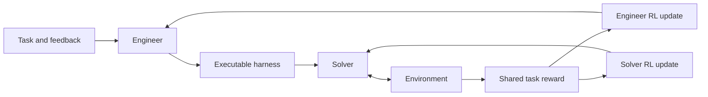

# JoMoHa: Joint Model-Harness Optimization with Reinforcement Learning

[](https://arxiv.org/abs/2611.11499)
[](https://huggingface.co/datasets/wxd02/coevolve/tree/d0e84414e8ef9e2b6a84585e1365189faf501051/best97)

**Train the agent. Train the runtime writer. Improve them together.**

JoMoHa jointly optimizes a language agent's **model weights** and **executable harness** through reinforcement learning. An **Engineer** learns to write the runtime, a **Solver** learns to act under it, and both improve from the outcome of the same task execution.

**[Paper](https://arxiv.org/abs/2611.11499) | [Checkpoints](#checkpoints) | [Getting started](#getting-started) | [Benchmark guide](docs/BENCHMARK_IMPLEMENTATIONS.md) | [Citation](#citation)**

## Highlights

- **Joint model-harness learning.** Train both the harness-generation policy and the task-execution policy from shared execution feedback.
- **Learning to improve.** The Engineer itself learns to construct better runtimes, enabling recursive self-improvement alongside the Solver.
- **Coordinated reinforcement learning.** Collaboration-aware critics, role-specific return normalization, partner-trajectory weighting, and asymmetric updates keep the two learners working together.
- **Strong results across three environments.** JoMoHa achieves **70.3% average success** across ALFWorld, WebShop, and DBBench, including **97.0% on ALFWorld**.
- **Research resources in one place.** Explore the training code, pinned benchmark runtimes, Engineer/Solver checkpoints, matching harness, and verifiable per-task experiment records.

## Results

Success rates reported in [the paper](https://arxiv.org/html/2611.11499v1):

| Method | ALFWorld | WebShop | DBBench | Average |
|---|---:|---:|---:|---:|
| **JoMoHa** | **97.0%** | **45.8%** | **68.0%** | **70.3%** |

JoMoHa improves average success over **Agent SFT + Harness-R1 by 6.1 percentage points** and **WHALE by 7.2 percentage points**. The average is the equally weighted mean of the three benchmark success rates.

## How it works



Each task attempt produces two complementary trajectories: the Engineer's generated program and the Solver's multi-turn execution. The shared task reward trains each policy on **its own generated tokens**, with separate actors and critics.

JoMoHa coordinates these updates through four mechanisms:

1. **Context:** collaboration-aware value estimation.
2. **ValueNorm:** role-specific return normalization.
3. **Peer:** bounded partner-trajectory weighting.
4. **Schedule:** asymmetric updates that give the Solver additional adaptation.

The repository retains the name `coevolve`; implementation files use **MA-SAO** for joint training and **SAO** for the single-rollout actor-critic backbone.

## Getting started

### 1. Get the code

```bash
git clone https://github.com/xudongwu-0/coevolve.git
cd coevolve
git submodule update --init --recursive
```

The pinned submodules provide WHALE, Harness-R1 benchmark runtimes, the SAO backbone, and the MAPPO design reference.

### 2. Explore the benchmarks

| Benchmark | Task | Entry point |
|---|---|---|
| ALFWorld | Household task completion | [Joint training and evaluation](whale_local/sao_bridge/) |
| WebShop | Goal-directed shopping | [Runtime, dataset builder, and evaluation](docs/BENCHMARK_IMPLEMENTATIONS.md#webshop) |
| DBBench | Database interaction | [Runtime, dataset builder, and evaluation](docs/BENCHMARK_IMPLEMENTATIONS.md#dbbench) |

See the [benchmark guide](docs/BENCHMARK_IMPLEMENTATIONS.md) for environment setup, source locations, and evaluation commands. WebShop and DBBench runtime components are integrated through the pinned official Harness-R1 submodule.

For the joint-training environment and patched AReaL source, follow the [training-source setup](docs/REPRODUCE_MA_SAO.md#restoring-the-training-source). The recorded 9B stack uses Python 3.12, PyTorch 2.10.0+cu129, vLLM 0.19.1, and Transformers 5.7.0.

### 3. Verify best97 offline

With **Python 3.10+**, run:

```bash
python3 -B scripts/reproduce_ma_progress.py --best97
```

This standard-library-only command checks **4,225 evidence files**, verifies the matching harness, and recomputes the best97 ALFWorld result from archived per-task outcomes. It runs locally without a GPU, model download, or API call; submodule initialization is optional for this step.

The JSON output includes:

```json
{
  "best97": {
    "selected": {
      "successes": 194,
      "questions": 200,
      "accuracy": 0.97
    }
  }
}
```

See the [reproducibility guide](docs/REPRODUCE_MA_SAO.md) for the full audit, archived experiments, and evidence extraction.

## Checkpoints

The **best97** release pairs the ALFWorld Solver and Engineer with the selected executable harness:

| Artifact | Link |
|---|---|
| Solver actor, configuration, and tokenizer | [best97/solver](https://huggingface.co/datasets/wxd02/coevolve/tree/d0e84414e8ef9e2b6a84585e1365189faf501051/best97/solver) |
| Engineer actor, configuration, and tokenizer | [best97/engineer](https://huggingface.co/datasets/wxd02/coevolve/tree/d0e84414e8ef9e2b6a84585e1365189faf501051/best97/engineer) |
| Matching executable harness | [proposal07](reproducibility/ma_sao_20261012/payload/runs/alfworld_ma_convergence_v1r4/block-01/round0096/patches/95-proposal07.json) |

Using the Hugging Face CLI, authenticate with `hf auth login` using an account with access to the dataset, then download the pinned checkpoint pair:

```bash
hf download wxd02/coevolve \
  --repo-type dataset \
  --revision d0e84414e8ef9e2b6a84585e1365189faf501051 \
  --include "best97/solver/*" "best97/engineer/*" \
  --local-dir models
```

The model directories are `models/best97/solver/` and `models/best97/engineer/`. Checkpoint identities and file hashes are recorded in the [artifact manifest](reproducibility/historical97_20261012/CHECKPOINT_UPLOAD_MANIFEST.json).

## Code overview

| Location | Contents |
|---|---|
| [`whale_local/sao_bridge/`](whale_local/sao_bridge/) | Joint learning, ALFWorld execution, evaluation, and checkpoint recovery |
| [`joint_workflow.py`](whale_local/sao_bridge/joint_workflow.py) | Paired Engineer/Solver rollouts |
| [`joint_critic.py`](whale_local/sao_bridge/joint_critic.py), [`joint_context.py`](whale_local/sao_bridge/joint_context.py) | Collaboration-aware value estimation |
| [`joint_updates.py`](whale_local/sao_bridge/joint_updates.py), [`joint_schedule.py`](whale_local/sao_bridge/joint_schedule.py) | Policy updates and role scheduling |
| [`third_party/harness-r1-upstream/`](third_party/harness-r1-upstream/) | Benchmark environments, harness hooks, dataset builders, and evaluation tools |
| [`scripts/`](scripts/), [`tests/`](tests/) | Preparation utilities, offline verification, and contract tests |
| [`reproducibility/`](reproducibility/) | Experiment evidence, source snapshots, and checkpoint metadata |

## Development

For the evidence-packaging and offline-verification tests, use an environment with `pytest` installed:

```bash
python3 -m pytest -q tests/test_ma_handoff.py tests/test_reproduce_ma_progress.py
python3 -B scripts/reproduce_ma_progress.py --best97
```

Contributions and issue reports are welcome. Include the repository revision, environment, command, and relevant error output; keep credentials and private infrastructure details out of reports. Preserve frozen evidence and add focused tests for behavior changes.

## Citation

```bibtex
@misc{lan2026jomoha,
  title         = {JoMoHa: Joint Model--Harness Optimization with Reinforcement Learning},
  author        = {Guangchen Lan and Mingqi Yuan and Jiayu Chen},
  year          = {2026},
  eprint        = {2611.11499},
  archivePrefix = {arXiv},
  primaryClass  = {cs.LG},
  url           = {https://arxiv.org/abs/2611.11499}
}
```

## Acknowledgments

JoMoHa builds on [WHALE](https://github.com/krafton-ai/WHALE), [Harness-R1](https://github.com/DeepExperience/Harness-R1), the [unofficial SAO implementation](https://github.com/fooSynaptic/Single-rollout-async-Optimization), and [AReaL](https://github.com/inclusionAI/AReaL). [MAPPO](https://github.com/marlbenchmark/on-policy) is included as a design reference.

See [third-party notices](THIRD_PARTY_NOTICES.md) and [component licenses](licenses/) for attribution and applicable terms. Model weights and benchmark assets follow their providers' terms.
