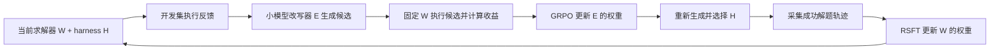

# Coevolve: trainable small-model harness–weight co-evolution

**基于 [WHALE](https://github.com/krafton-ai/WHALE) 的双模型交替改进：不仅训练求解器，也训练负责改写 harness 的小模型。**

**当前主线与 Agent 接手入口：[项目状态、主要结果和失败门槛](docs/PROJECT_STATE.md)。**
下面的双2B配置和第一版结果是历史试验；当前研究在官方9B Harness-R1复现、
4B编辑能力和SAO/MA-SAO之间推进。尚未证明稳定、可泛化的RL harness改写收益。

WHALE 把求解器权重更新与可执行 harness 搜索交替进行。Coevolve 在这一框架上，将外部 harness 提案模型替换为一个可以继续训练的 2B 改写器：它读取当前 harness 和开发集失败反馈，生成 Python 代码；候选在当前求解器上的实际收益，反过来用于更新改写器自身的权重。

我们维护两个独立 checkpoint，均使用 Qwen3.5-2B：

| 状态 | 职责 | 更新方法 |
|---|---|---|
| 求解器 `W` | 在 harness 中推理、调用 Python、回答题目 | 原生 WHALE RSFT：用在线采样中通过 verifier 的成功轨迹训练 |
| 改写器 `E` | 根据当前代码与失败反馈生成新的 harness | 合成代码编辑 SFT 初始化；随后使用 Harness-R1 风格的 outcome GRPO |
| 执行代码 `H` | 提示、工具反馈处理、停止与恢复行为 | 执行候选并比较开发集表现，用 WHALE 的 Pareto/接受规则选择 |



## 相对 WHALE 的主要扩展

1. **可训练的小模型改写器。** Harness 生成能力是一个被优化的模型参数状态，不再只依赖固定外部提案模型。
2. **与当前求解器绑定的编辑奖励。** 固定当前 `W`，在相同开发题和采样协议下计算 `score(W, H_candidate) − score(W, H_current)`；更新求解器后重新计算编辑奖励。
3. **双 checkpoint 的真实训练和交接。** 独立保存模型、优化器、随机状态和参数摘要；更新后重载验证，分别记录代码收益、求解器训练与改写器训练。
4. **小规模本地执行后端。** 复用 WHALE 的 ReTool 环境、严格 boxed verifier、RSFT actor 和 harness 选择器，补充 Transformers 服务、原始 token 记录、隔离 Python 执行和多 GPU 采样。

Harness 搜索允许修改提示和可执行恢复钩子，包括 `no_tools_called` 与 `get_prompt_messages`；不是只改一句 prompt。工具、判题器和总输出预算保持固定。当前代码编辑接口有明确限制，详见 [方法与边界](docs/METHOD.md)。

## 第一版实验结果

MATH `number_theory` 的本地小子集：Level 2–4、整数 boxed 答案。训练128题、开发48题、评测128题。下表和图统一采用 **同一128题、每题1次采样，seed=42、temperature=1**。

三组共同起点是已训练求解器加初始 harness；两个内部组共享同一份已有132步 SFT、尚无 RL 更新的改写器。

| 改写方法 | 共同起点 | 第一次 H 更新后 | W 训练后 | 第二次 H 更新后 |
|---|---:|---:|---:|---:|
| 外部模型改写 | 78/128 | 90/128 | 92/128 | 92/128 |
| 固定内部 2B 改写器 | 78/128 | 69/128 | 71/128 | 84/128 |
| 继续训练内部 2B 改写器 | 78/128 | 69/128 | 71/128 | **93/128** |


训练内部改写器比固定内部改写器最终多解 **9题（+7.03个百分点）**，是当前协议下的初步信号。内部第一轮有明显回落；尚未证明持续、单调自我改进，也不能凭93与92的一题差异宣称优于外部模型。

这个对照有实质限制：最终选择只用训练后4个候选与 incumbent，固定组的训练后候选复用训练前相同种子；训练组第二轮的强候选已经在训练前8个候选中出现。观察到的是训练提高了匹配槽位中再生成该候选的频率，尚不能证明优于保留所有已评估候选的搜索策略。

各组新增32条求解器训练轨迹；外部/固定内部/训练内部的实际开发搜索采样分别为1056/432/480条。**相同提案槽位和预算上限不等于相同实际 rollout 或总成本。** 历史初始化成本和外部模型推理成本另计。这是快速单 seed 实验，评测题有历史使用记录，不是论文全量复现或新盲测。

[详细实验解释](docs/EXPERIMENTS.md) · [数值记录](docs/results/pilot.json) · [曲线 PDF](docs/figures/three_arm_curve.pdf)

## 代码和运行

```bash
git clone --recurse-submodules https://github.com/xudongwu-0/coevolve.git
cd coevolve
```

上游 WHALE 作为 submodule 固定在 `fbe125eb7abea7f760c99ab9acc1a6261e708fc6`。我们的扩展位于 `whale_local/`，上游源码保持独立。

运行准备、依赖、SFT 初始化及 checkpoint 格式见 **[运行指南](docs/RUNNING.md)**。发布版提供新的显式配置入口：

```bash
# 先按运行指南建立环境，并填写模型、数据及空闲 GPU 路径。
cp examples/pilot.json examples/local.json
export PYTHONPATH="$PWD/whale_local:$PWD/WHALE/domains/math_reasoning:$PWD/WHALE/domains/chess_puzzles"
.venv-whale-search/bin/python scripts/prepare_run.py \
  --spec examples/local.json --run runs/pilot --check-only
.venv-whale-search/bin/python scripts/prepare_run.py \
  --spec examples/local.json --run runs/pilot
.venv-whale-search/bin/python whale_local/three_arm_hwh.py execute --run runs/pilot
```

示例默认比较固定/可训练内部改写器，两个阶段均不需要外部提案服务。加入 `external` 分支后，必须有实际外部模型或人工代理消费 FastAPI 提案队列；该队列本身不会生成代码。历史外部对照由活跃 Codex 会话处理，未提供无人值守的 Codex 模型 API。

另提供隔离的[双 SAO 集成测试入口](docs/SAO_BASELINE.md)：直接调用固定版本的开源 SAO/AReaL 训练器，分别更新改写器与执行模型。它采用受限 harness 属性空间和独立 critic，不是 MAPPO，也不替代本文已有的 RSFT/GRPO 实验结果。

| 文件 | 作用 |
|---|---|
| [three_arm_hwh.py](whale_local/three_arm_hwh.py) | H → W → H 的固定改写器、可训练改写器及外部对照 |
| [harness_learner.py](whale_local/harness_learner.py) | 改写器 SFT 初始化 |
| [harness_grpo.py](whale_local/harness_grpo.py) | 基于执行收益的改写器权重更新 |
| [alternating_solver_train.py](whale_local/alternating_solver_train.py) | 求解器 RSFT |
| [alternating_pool.py](whale_local/alternating_pool.py) | 本机/内网冻结求解器副本并行采样 |
| [harness_code_contract.py](whale_local/harness_code_contract.py) | 候选代码接口检查 |
| [prepare_run.py](scripts/prepare_run.py) | 显式资产与设备配置、数据划分检查 |
| [check_install.py](scripts/check_install.py) | 不加载模型的导入、奖励和执行环境检查 |

本仓库包含代码、运行说明和聚合实验结果；模型权重、优化器、原始轨迹、MATH 数据与旧工作区环境需单独准备。历史研究脚本保留于 `whale_local/`，部分仍依赖原实验目录；新实验使用上述入口。完整历史结果无法仅靠本仓库重算，聚合数值及其限制已单独记录。

## 其他探索与来源

曾尝试根据失败标签将采样预算分配给 harness/weight 问题。当前 gate 实验没有显示样本效率优势，**不是本项目主结果**，见 [gate 流程与失败分析](docs/GATE.md)。

本项目建立在 [WHALE](https://github.com/krafton-ai/WHALE) 之上，改写器优化参考 Harness-R1 的组相对 outcome 奖励思路。WHALE 及其 vendored verl 等组件保留各自许可和署名，见 [第三方说明](THIRD_PARTY_NOTICES.md)。
